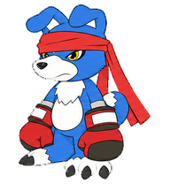
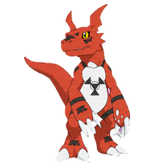
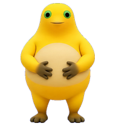
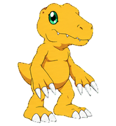
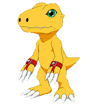

# Codex Pets

本地 Codex Pet 合集。保留每只宠物的原名称、ID 和图集版本。

| 宠物 | 预览 | 安装包 |
|---|---|---|
| 上原步梦 (`ayumu-uehara`) |  | [下载 ZIP](packages/ayumu-uehara.zip) |
| 菲比 (`feibi`) |  | [下载 ZIP](packages/feibi.zip) |
| 加奥兽 (`gaomon`) |  | [下载 ZIP](packages/gaomon.zip) |
| 咕嘎 (`guga`) |  | [下载 ZIP](packages/guga.zip) |
| 基尔兽 (`guilmon`) |  | [下载 ZIP](packages/guilmon.zip) |
| 大笑奶龙 (`happynailong`) |  | [下载 ZIP](packages/happynailong.zip) |
| 冰川纱夜 (`hikawa-sayo`) |  | [下载 ZIP](packages/hikawa-sayo.zip) |
| 亚古兽（一代） (`agumon-adventure`) |  | [下载 ZIP](packages/agumon-adventure.zip) |
| 亚古兽（五代） (`agumon-savers`) |  | [下载 ZIP](packages/agumon-savers.zip) |

## 安装

解压单只宠物的 ZIP，将其中同名目录放入 `~/.codex/pets/`。Windows 对应 `%USERPROFILE%\.codex\pets\`。在 Codex 的设置 → 宠物（Pets）或 `/pet` 中选择。替换前请自行保留旧版备份。

## 内容

`pets/` 存放可直接安装的文件，`packages/` 存放逐只安装包，`previews/` 存放预览，`catalog.json` 记录版本、尺寸与 SHA-256。基尔兽与加奥兽按已确认的动画形象修正，动作采用数码宝贝自身的身体结构和神态，行走槽不挥手。其他宠物保持本地安装内容。

网站版本使用中文显示名，数码宝贝的网站 ID 统一带 `-anime`：[基尔兽](https://codex-pets.net/#/pets/guilmon-anime)、[加奥兽](https://codex-pets.net/#/pets/gaomon-anime)、[亚古兽（一代）](https://codex-pets.net/#/pets/agumon-adventure-anime)、[亚古兽（五代）](https://codex-pets.net/#/pets/agumon-savers-anime)。本仓库与本地安装目录保留原 ID，避免重复安装。

角色及第三方宠物素材的权利属于各自权利人。本合集不另行授予这些素材的版权许可。

加奥兽与基尔兽的简介依据官方图鉴概括：[加奥兽设定](https://digimon.net/reference_zh-CHS/detail.php?directory_name=gaomon)、[基尔兽设定](https://digimon.net/reference_zh-CHS/detail.php?directory_name=guilmon)。
